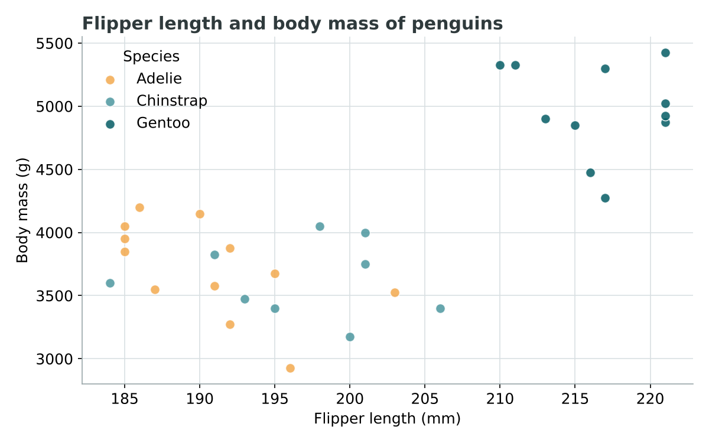

In this session, you read a spreadsheet into R, and take a first look at
your data.

## The data

We use measurements of penguins from three islands. Download the file
[penguins.csv](../../docs/penguins.csv), and save it in your project
folder.

{width=70% fig-align="left"}

## Read the file

Use `read_csv()` from the readr package to read the file:

```r
library(readr)
penguins <- read_csv("penguins.csv")
```

## Exercise

How many penguins are in the dataset? And how many columns does it have?

::: {.callout-tip collapse="true"}
## Solution

Use `nrow()` and `ncol()`:

```r
nrow(penguins)
ncol(penguins)
```
:::

Want to know more? See the
[readr documentation](https://readr.tidyverse.org/).